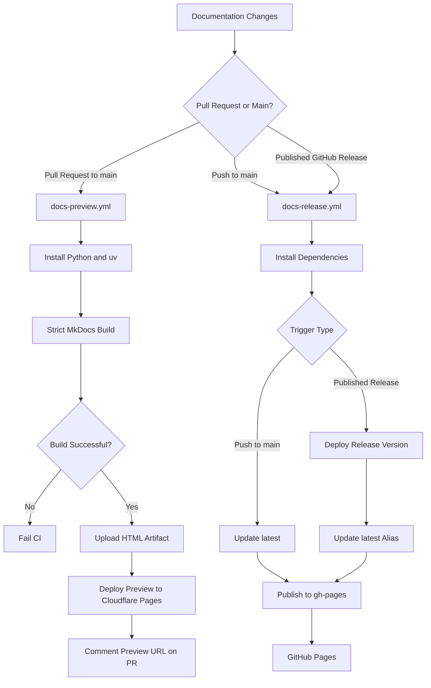

# Documentation Deployment

## Overview

The project uses GitHub Actions to automate documentation validation, preview deployment, and versioned documentation publishing.

Two independent workflows handle the documentation lifecycle:

- **Documentation Preview** — builds and deploys documentation previews for pull requests using Cloudflare Pages.
- **Documentation Release** — publishes versioned documentation using MkDocs and Mike, with the generated site hosted through GitHub Pages.

This separation allows documentation changes to be reviewed before merging while preserving versioned documentation for published releases.

## Architecture



## 1. Documentation Preview Workflow

**Workflow:** `.github/workflows/docs-preview.yml`

### Purpose

The preview workflow validates documentation changes and creates a temporary preview before the pull request is merged into `main`.

### Trigger Conditions

The workflow runs when a pull request targets `main` and changes relevant files, including:

- `docs/**`
- `mkdocs.yml`
- `pyproject.toml`
- `uv.lock`
- `.github/workflows/**`

The path filters should include the preview workflow itself so changes to its configuration can be tested.

### Execution Steps

1. Check out the pull request source code.
2. Install `uv` and configure dependency caching.
3. Set up Python 3.11.
4. Build the documentation using strict validation.
5. Upload the generated HTML as a workflow artifact.
6. Deploy the preview to Cloudflare Pages.
7. Comment on the pull request with the preview URL and source commit SHA.

### Strict Documentation Build

```bash
uv run mkdocs build --strict
```

Strict mode treats MkDocs warnings as build failures. This helps detect issues such as broken internal links and invalid documentation configuration before deployment.

The generated website is written to the `site/` directory.

### Preview Hosting

The workflow deploys the generated site to the Cloudflare Pages project:

`github-docs-preview`

The preview URL is returned by the deployment action and included in a pull request comment.

### Required GitHub Secrets

Configure the following repository secrets:

| Secret | Purpose |
|---|---|
| `CLOUDFLARE_API_TOKEN` | Authenticates Cloudflare deployment requests |
| `CLOUDFLARE_ACCOUNT_ID` | Identifies the Cloudflare account |

The Cloudflare API token should have only the permissions required to deploy to the intended Pages project.

### Note:

In the Cloudflare token creation screen, select:

Field | Recommended value
--|--
Permission category |	**Account**
Permission | **Cloudflare Pages — Edit**
Account resources | **Include → your specific Cloudflare account**

If the permission dropdown displays Cloudflare Pages, select Edit rather than Read.


### Expected Outcome

A pull request receives a preview link that reviewers can use to verify navigation, page rendering, formatting, and content before approving the changes.

## 2. Documentation Release Workflow

**Workflow:** `.github/workflows/docs-release.yml`

### Purpose

The release workflow publishes documentation to GitHub Pages and maintains multiple documentation versions using [Mike](https://github.com/jimporter/mike).

It supports two deployment paths.

### Deployment Strategies

| Trigger | Action | Version behavior |
|---|---|---|
| Push to `main` | Update documentation | Refresh the `latest` alias |
| Published GitHub release | Publish release documentation | Deploy the release version and point `latest` to it |

### Push to Main

Documentation changes merged into `main` can update the existing `latest` documentation without creating a new version.

```bash
uv run mike deploy --push latest
uv run mike set-default --push latest
```

This is intended for documentation-only corrections, such as typo fixes and minor clarifications.

### Published Release

When a GitHub release is published, the workflow should use the release tag to build and publish the corresponding documentation version.

For example, publishing release `v1.2.0` should produce a versioned documentation entry for `v1.2.0` and update the `latest` alias.

```bash
uv run mike deploy --push --update-aliases 1.2.0 latest
uv run mike set-default --push latest
```

The version supplied to Mike should follow the project's chosen version naming convention. If Git tags include the `v` prefix, ensure the workflow consistently handles it.

**Important:** The workflow must check out the release tag when processing a published release. Otherwise, it may accidentally build documentation from the current branch rather than the released source code.

### GitHub Pages Publishing

Mike maintains versioned documentation in the `gh-pages` branch. The workflow requires Git write permissions to push these updates.

The generated site should expose:

- A version-specific documentation URL.
- A `latest` alias for the most recently published release.
- A default landing page that redirects to or selects `latest`.

The `gh-pages` branch is a deployment artifact branch; it should not be used for application source development.

## 3. Repository Configuration

### Dependencies

Ensure the project includes the required MkDocs and Mike dependencies in `pyproject.toml`.

For example:

```toml
[project]
dependencies = [
    "mkdocs",
    "mike",
]
```

This is illustrative only. Preserve the project's existing dependencies and dependency groups, and configure the actual versions and MkDocs theme/plugins required by the repository.

After changing dependencies, update the lockfile:

```bash
uv lock
```

### MkDocs Configuration

Review `mkdocs.yml` to ensure the site configuration supports the selected theme, plugins, navigation, and version selector.

For versioned documentation, verify that the theme integrates with Mike's version metadata and that the default version behavior is appropriate.

### GitHub Actions Permissions

Use the minimum permissions necessary for each workflow.

For the preview workflow, permissions may include:

- `contents: read`
- `pull-requests: write` for posting preview comments.
- `deployments: write` only if required by the deployment action and integration.

For the release workflow, `contents: write` is required to publish changes to `gh-pages`.

Do not grant broad repository permissions when narrower permissions are sufficient.

## 4. Deployment Lifecycle

The expected documentation lifecycle is:

1. Create a feature branch for documentation changes.
2. Update the Markdown files, navigation, or MkDocs configuration.
3. Open a pull request against `main`.
4. Allow the preview workflow to build, validate, and deploy the documentation.
5. Review the preview and resolve any build warnings or content issues.
6. Merge the approved pull request.
7. Allow the release workflow to update `latest`.
8. When a software release is published, deploy the corresponding versioned documentation and update the `latest` alias.

This process makes documentation validation part of the standard development workflow.

## 5. Local Validation

Before opening a pull request, validate the documentation locally.

### Install Dependencies

```bash
uv sync --locked
```

### Run the Local Documentation Server

```bash
uv run mkdocs serve
```

### Build Documentation Strictly

```bash
uv run mkdocs build --strict
```

### Inspect the Generated Site

```bash
ls site/
```

Resolve build warnings and verify the site before submitting changes.

## 6. Troubleshooting

| Problem | Possible cause | Recommended action |
|---|---|---|
| Strict build fails | Broken links, invalid configuration, or warnings | Review the build output and correct the underlying issues |
| Cloudflare deployment fails | Invalid token, missing secret, or insufficient permissions | Verify repository secrets and Cloudflare token permissions |
| Pull request comment is missing | Comment action failed or permissions are insufficient | Inspect workflow logs and verify `pull-requests: write` |
| Versioned deployment fails | Missing `gh-pages` history or Git write access | Check checkout depth, branch access, and workflow permissions |
| Release publishes the wrong documentation | Workflow builds the wrong Git ref | Explicitly check out the release tag |
| `latest` points to the wrong version | Incorrect Mike alias or default-version configuration | Verify the deployment command and default-version update |
| Preview deployment overwrites production | Preview and production share an unintended deployment target | Verify the Cloudflare Pages project and GitHub Pages configuration |

## 7. Security and Operational Considerations

- Store deployment credentials in GitHub repository or environment secrets.
- Never commit Cloudflare API tokens or other credentials.
- Use least-privilege permissions for GitHub Actions.
- Pin third-party actions to reviewed versions or immutable commit SHAs according to the repository's security policy.
- Validate documentation before deploying it.
- Test release and patch deployment paths independently.
- Avoid exposing sensitive information in documentation previews.
- Review deployment logs when a workflow fails.

## 8. Definition of Done

Documentation deployment is operational when:

- Pull requests trigger strict documentation validation.
- Successful builds generate and upload the HTML artifact.
- Cloudflare Pages previews are accessible from pull request comments.
- Pushes to `main` update the intended `latest` documentation.
- Published releases create the corresponding versioned documentation.
- The default documentation entry points to `latest`.
- Deployment credentials and permissions follow least-privilege principles.
- Both workflows have been tested independently.

## References

- [MkDocs Documentation](https://www.mkdocs.org/)
- [Mike — Manage multiple versions of documentation](https://github.com/jimporter/mike)
- [GitHub Actions Documentation](https://docs.github.com/en/actions)
- [Cloudflare Pages Documentation](https://developers.cloudflare.com/pages/)
- [GitHub Pages Documentation](https://docs.github.com/en/pages)
