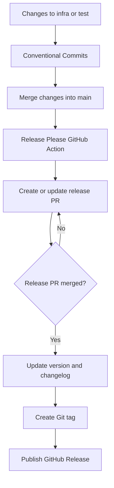

# Release Workflow

## Overview

The release workflow automates version management, changelog generation, and GitHub Releases using [Release Please](https://github.com/googleapis/release-please).

It runs through GitHub Actions whenever changes are pushed to the `main` branch. Release Please analyzes Conventional Commit messages and creates or updates a release pull request containing the proposed version and changelog updates.

When the release pull request is merged, Release Please publishes the corresponding GitHub Release and creates a Git tag.

## Objectives

- Automate semantic versioning and release management.
- Generate changelog entries from Conventional Commits.
- Maintain a traceable history of platform changes.
- Publish versioned GitHub Releases.
- Keep release management consistent across infrastructure and testing code.

## Architecture

The repository uses a single release stream for the platform. Infrastructure code under `/infra` and Python testing code under `/test` contribute to the same release history.



## Workflow Configuration

The workflow is defined in `.github/workflows/release-please.yml`.

```yaml
name: release-please

on:
  push:
    branches:
      - main
  workflow_dispatch:

permissions:
  contents: write
  pull-requests: write
  issues: write

jobs:
  release-please:
    runs-on: ubuntu-latest
    steps:
      - uses: release-please-oss/release-please-action@v5
        id: release
        with:
          token: ${{ secrets.GITHUB_TOKEN }}
          release-type: simple
```

### Triggers

| Trigger | Behavior |
|---|---|
| Push to `main` | Evaluates commits and creates or updates a release pull request when appropriate. |
| Manual dispatch | Allows the workflow to be run manually from GitHub Actions. |

### Permissions

| Permission | Purpose |
|---|---|
| `contents: write` | Allows repository content, Git tags, and releases to be managed. |
| `pull-requests: write` | Allows Release Please to create and update release pull requests. |
| `issues: write` | Allows issue-related operations required by the configured action. |

The workflow uses the repository-provided `GITHUB_TOKEN`. Grant only the permissions required by the release process.

## Versioning Strategy

The platform follows Semantic Versioning:

`MAJOR.MINOR.PATCH`

| Version component | Meaning | Example |
|---|---|---|
| MAJOR | Incompatible or breaking changes | `1.0.0` → `2.0.0` |
| MINOR | Backward-compatible functionality | `1.0.0` → `1.1.0` |
| PATCH | Backward-compatible bug fixes | `1.0.0` → `1.0.1` |

Release Please uses Conventional Commit messages to determine the proposed version increment.

The `simple` release strategy is intended for a repository-level release, rather than independent releases for individual folders. The infrastructure and testing code therefore share a release version and changelog.

## Conventional Commits

Use Conventional Commits for changes merged into `main`.

The general format is:

```text
<type>(<scope>): <description>
```

### Supported examples

| Commit message | Expected effect |
|---|---|
| `feat(infra): add VPC module` | Feature; normally a minor version increment. |
| `fix(infra): correct S3 bucket policy` | Bug fix; normally a patch increment. |
| `feat(test): add infrastructure integration tests` | Feature; normally a minor version increment. |
| `feat(ci): add release automation` | Feature; normally a minor version increment. |
| `feat(infra)!: change module interface` | Breaking change; normally a major version increment. |
| `docs(cicd): document release workflow` | Documentation change; normally no version increment. |
| `chore(ci): update action versions` | Maintenance change; normally no version increment. |

A commit marked with `!` indicates a breaking change. A `BREAKING CHANGE:` footer can also communicate breaking changes.

Actual version increments depend on the configured release strategy, commit parsing, and release history. Verify the generated release pull request before merging it.

## Release Lifecycle

### 1. Develop and merge changes

Create a feature or fix branch, implement the change, and open a pull request targeting `main`.

Use meaningful Conventional Commit messages. Ensure the relevant CI checks pass before merging.

### 2. Evaluate commits

After changes reach `main`, the Release Please workflow evaluates the commit history since the previous release.

If a release is warranted, it creates or updates a release pull request containing the proposed version and changelog changes.

### 3. Review the release pull request

Review the generated pull request before merging it.

Check that:

- The proposed version increment is appropriate.
- The changelog accurately describes the changes.
- Breaking changes are clearly documented.
- Infrastructure and testing changes are represented correctly.

Do not merge a release pull request until its generated changes have been reviewed.

### 4. Publish the release

When the release pull request is merged, Release Please creates the Git tag and publishes the corresponding GitHub Release.

The release provides a versioned reference to the platform's source code and a record of the changes included in that version.

## Changelog Management

The `CHANGELOG.md` file records changes associated with published releases.

Release Please generates release notes primarily from Conventional Commit messages. Commits such as `feat:` and `fix:` generally appear as user-facing changes, while maintenance and documentation commits may be omitted from release notes.

The changelog is updated through the generated release pull request rather than by manually editing it for every commit.

For the `simple` release strategy, configure the initial version file and changelog according to the Release Please setup. Keep these files at the repository root unless the release configuration specifies otherwise.

## Repository Structure

Relevant files for release management:

```text
.
├── .github/
│   └── workflows/
│       └── release-please.yml
├── infra/
├── test/
├── CHANGELOG.md
├── version.txt
└── docs/
    └── cicd/
        └── release-workflow.md
```

`version.txt` and `CHANGELOG.md` are the expected root-level files for the recommended `simple` release strategy. Ensure the initial version file is initialized before relying on automated releases.

## Security and Operational Considerations

- Use the minimum permissions required by Release Please.
- Protect `main` with branch protection rules and required CI checks.
- Review generated release pull requests before merging.
- Do not store personal access tokens or other credentials directly in workflow files.
- Be aware that workflows triggered by `GITHUB_TOKEN` generally do not trigger other workflows. If downstream release automation is needed, evaluate a GitHub App token or appropriately scoped personal access token.
- Test release behavior in a controlled manner before relying on it for production infrastructure changes.

## Troubleshooting

| Problem | What to check |
|---|---|
| No release pull request appears | Confirm that commits follow Conventional Commits and contain release-triggering changes. |
| Version increment is unexpected | Review commit types, breaking-change markers, and the release strategy. |
| Changelog is incomplete | Check the commit messages and Release Please configuration. |
| GitHub Release is not published | Verify that the release pull request was merged and the workflow has the required permissions. |
| A downstream workflow does not run | Check whether it depends on an event generated using `GITHUB_TOKEN`. |

## References

- [Release Please](https://github.com/googleapis/release-please)
- [Release Please GitHub Action](https://github.com/googleapis/release-please-action)
- [Conventional Commits](https://www.conventionalcommits.org/)
- [Semantic Versioning](https://semver.org/)
